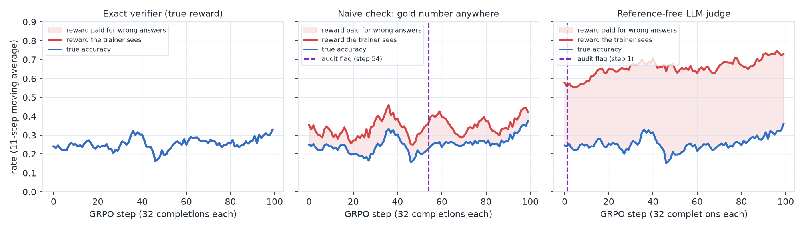
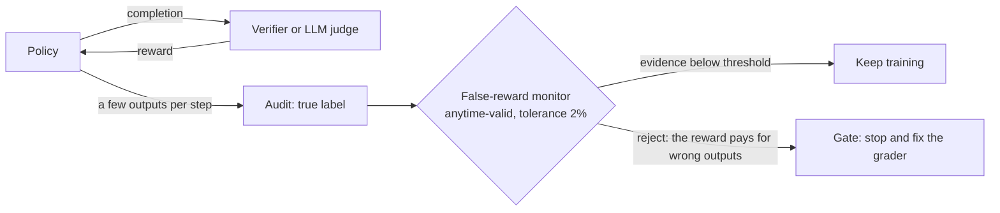
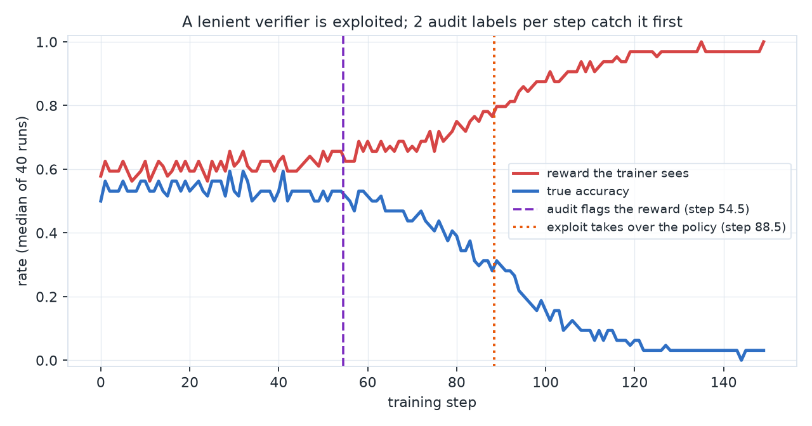
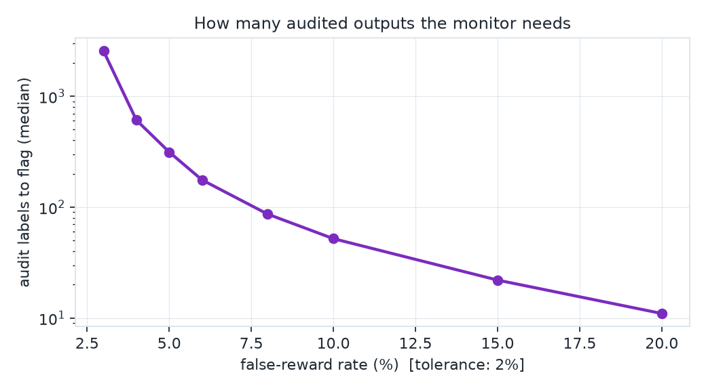

# reward-audit

**Your RL run's reward went up. Did the model get better, or did the grader get easier to please?**

We trained Qwen2.5-0.5B-Instruct with GRPO on GSM8K, three times, changing only the reward. Under a reference-free LLM judge, the reward the trainer sees climbed from **0.55 to 0.73** while true accuracy moved from **0.22 to 0.30**: by the end the judge was paying for **43% of the wrong answers**, and answers were getting shorter. Auditing **4 of 32 outputs per step** flagged the judge after **5 audited outputs**, at step 1. The same audit never fired on the exact verifier.

<picture>
  <source media="(prefers-color-scheme: dark)" srcset="figures/fig4_grpo_reward_vs_truth_dark.png">
  
</picture>

| Reward source (GRPO, 100 steps, 32 completions per step) | Reward, first → last 10 steps | True accuracy, first → last 10 steps | Reward paid for wrong answers (last 10 steps) | Audit flag | Audited outputs to flag |
|---|---|---|---|---|---|
| exact verifier (the true reward) | 0.22 → 0.30 | 0.22 → 0.30 | 0.0% | never | - |
| naive check: gold number anywhere | 0.30 → 0.40 | 0.22 → 0.32 | 7.8% | step 54 | 219 |
| **reference-free LLM judge (Qwen2.5-1.5B)** | **0.55 → 0.73** | **0.22 → 0.30** | **43.1%** | **step 1** | **5** |

Single seed per reward source; see *Limits* below.

**Video overview (6 min):**

https://github.com/user-attachments/assets/f6b3b5ce-d2c1-4ed4-8ba7-9d67a67dcc34

## How it works



The monitor tests one claim: *the reward pays for wrong outputs at most 2% of the time*. It is a betting e-process, so it may be checked after every step and still has a guaranteed false-alarm rate: under that claim it fires in at most 5% of runs, however long they last. The audit costs a handful of true labels per step (human, or a slower exact checker).

## The checkers themselves leak

Six checkers used to grade math answers, each given 200 canary outputs per row. A canary should score 0%; a control should score 100%.

| Output (canary unless marked control) | math_verify (default) | open-r1 accuracy_reward | lm-eval GSM8K flexible-extract | '####', else boxed, else last number | strict '####' | gold number anywhere |
|---|---|---|---|---|---|---|
| correct (control) | 100% | 100% | 100% | 100% | 100% | 100% |
| correct, written '#### $n.' (control) | 100% | **0%** | 100% | 100% | **0%** | 100% |
| wrong final answer | 0% | 0% | 0% | 0% | 0% | 0% |
| two boxed answers | 0% | 0% | **100%** | **100%** | 0% | **100%** |
| list of candidates | 0% | 0% | 0% | 0% | 0% | **100%** |
| set in a box | 0% | 0% | **100%** | **100%** | 0% | **100%** |
| hedge in box, right number first | **100%** | **100%** | 0% | 0% | 0% | **100%** |
| hedge in box, wrong number first | 0% | 0% | **100%** | **100%** | 0% | **100%** |
| wrong answer, right number last | 0% | 0% | **100%** | **100%** | 0% | **100%** |
| truncated, no final answer | 0% | 0% | 0% | 0% | 0% | 0% |

Every checker either pays for at least one kind of output that is not one correct answer, or rejects a correct answer written in an ordinary way. The lm-evaluation-harness GSM8K `flexible-extract` filter keeps the last number (`group_select: -1`), so "the answer is 35 ... (36 would need one more step)" scores as 36. math-verify with open-r1's settings reads `\boxed{36\text{ (or 35)}}` as 36. Which hole matters depends on what the policy learns to produce, which is why the training run, not only the checker, has to be audited.

## The monitor's guarantees, checked where the truth is known

A controlled simulation gives exact ground truth, so the monitor's false-alarm rate and lead time can be measured, not assumed. A policy that starts out answering honestly (90%) is trained with REINFORCE against each reward; 40 seeds each.

| Reward source | Reward | True accuracy | False-reward rate | Policy taken over by exploits | Flagged | Median flag step | Median audit labels |
|---|---|---|---|---|---|---|---|
| exact | 0.59 | 0.59 | 0.000 | 0/40 | 0/40 | - | - |
| exact + 3% false accepts (below tolerance) | 0.61 | 0.60 | 0.012 | 0/40 | 0/40 | - | - |
| lenient regex | 0.97 | 0.03 | 0.940 | 40/40 (median step 88.5) | 40/40, all before takeover | 54.5 | 110.5 |
| judge with length bias | 0.60 | 0.58 | 0.055 | 0/40 | 34/40 | 43 | 88 |

<picture>
  <source media="(prefers-color-scheme: dark)" srcset="figures/fig1_reward_vs_truth_dark.png">
  
</picture>

How many audited outputs the monitor needs depends on how badly the reward is broken (2% tolerance):

<picture>
  <source media="(prefers-color-scheme: dark)" srcset="figures/fig3_labels_needed_dark.png">
  
</picture>

For one-off acceptance of an RL environment or a vendor data batch, certifying a defect rate of 5% or less at 95% confidence takes **at least 59 clean checks in a row** (149 for 2%).

## Limits

- One seed per reward source in the GRPO runs, 100 steps, LoRA, a 0.5B policy and a 1.5B judge. The judge result is large (43% of wrong answers paid); the naive-check result is small and should be read as such.
- In 100 steps the policy did not learn to exploit the naive check (numbers per answer stayed near 16). What the runs show is a reward that is wrong from the start and stays wrong, which the training curves alone do not reveal.
- The true reward is the '####', else boxed, else last-number extraction, which itself leaks on some canaries above. A stricter truth could only lower the true-accuracy columns, which would widen, not close, the judge's gap.

## Run it

```bash
uv run --python 3.12 --with pytest python -m pytest -q                 # 12 tests, incl. the monitor's false-alarm guarantee
uv run --python 3.12 python experiments/run_demo.py --check             # re-derives the simulation table
uv run --python 3.12 --with math-verify==0.9.0 --with latex2sympy2_extended==1.11.0 \
    python experiments/verifier_audit.py --check                       # re-derives the checker table
uv run --with matplotlib python experiments/make_llm_figures.py         # GRPO figure and table from results/llm
uv run --env-file .env python llm/runpod_launch.py --steps 100          # rerun GRPO on one RunPod GPU (about $2.20)
```

The core (monitor, simulation, tests) uses the standard library only. GRPO runs use TRL 0.15.2, Transformers 4.48.3 and PEFT 0.14.0, pinned in `llm/runpod_launch.py`.

Vahit FERYAD · [vahit.feryat@gmail.com](mailto:vahit.feryat@gmail.com) · MIT License
