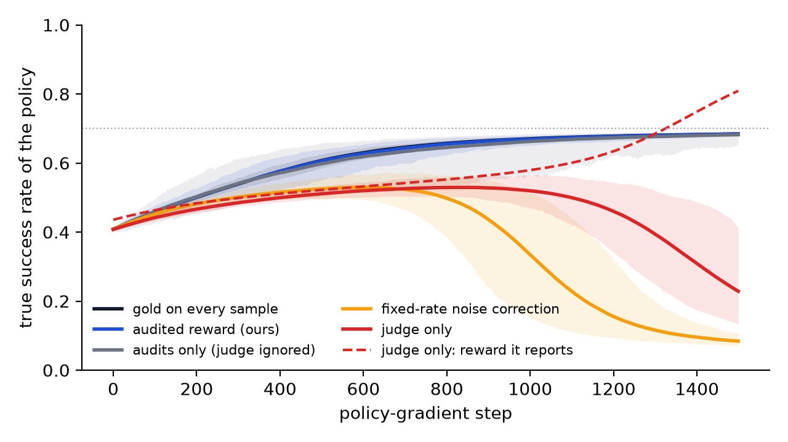
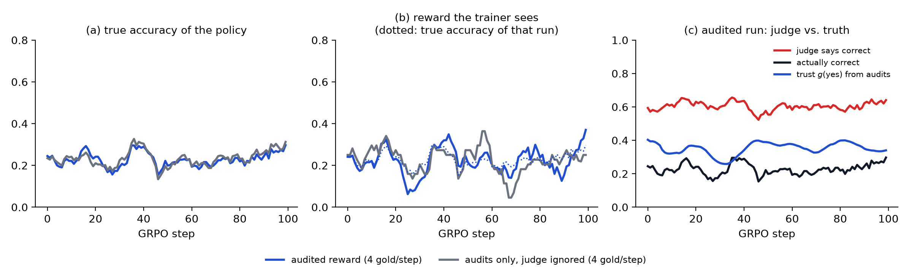

# Audited rewards: unbiased RL from an exploitable judge

**Paper:** [Noise Is Not Noise When the Policy Chooses It: Unbiased Reinforcement Learning from an Exploitable Judge with Random Audits](paper/Unbiased_RL_from_an_Exploitable_Judge_with_Random_Audits.pdf)

The monitor in the parent folder detects a reward that pays for wrong answers. This folder fixes it during training. The judge scores every output; after the outputs exist, one in eight is picked at random and checked against the answer key. Each output is paid

```
r = g(j) + xi * (y - g(j)) / p
```

where `j` is the judge's verdict, `y` the true label, `xi` = 1 if the output was audited, `p` the audit rate, and `g(j)` the judge's precision on the current policy, estimated from past audits. It works like a tax audit: if any answer may be checked and a caught discrepancy costs 1/p times its size, fooling the judge earns nothing in expectation.

## What the paper proves

1. **Fixed corrections can be fooled.** Any method that sees only judge outputs, or gold labels collected before training, can be driven to a bad policy (Proposition 1). This includes noise correction with error rates estimated on a held-out set.
2. **Audited rewards are unbiased.** The leave-one-out policy gradient is unbiased for the true objective under every policy and every judge error pattern (Theorem 2).
3. **The price is exact.** The extra variance is `E[(1/p - 1)(y - g)^2]`. The best `g` is the judge's on-policy calibration, the best audit allocation is Neyman's, and a judge is worth exactly the share of the gold signal it explains on the policy's own outputs (Theorem 3).
4. **The same audits raise an alarm** that stays valid however often it is checked (Proposition 4).

## Results

**Controlled exploit** (200 seeds; the best achievable true success is 0.70):

| Reward used for training | Gold labels | True success at the end |
|---|---|---|
| gold label on every sample | 12,000 | 0.684 |
| judge only | 0 | 0.229 |
| fixed-rate noise correction | 1,500 | 0.084 (every seed on the exploit) |
| audits only, judge ignored | 1,500 | 0.682 |
| **audited reward** | **1,500** | **0.684** |

With 1/32 of the labels, audits that ignore the judge fall to 0.656 and the audited reward stays at 0.682.



**GRPO on GSM8K** (Qwen2.5-0.5B-Instruct policy, Qwen2.5-1.5B-Instruct judge without the answer key, 100 steps, one seed):

| Reward used for training | Gold labels | Reward the trainer sees (mean) | True accuracy (mean) |
|---|---|---|---|
| gold label on every sample | 3,200 | 0.255 | 0.255 |
| judge only | 0 | **0.657** | 0.255 |
| audits only, judge ignored | 400 | 0.225 | 0.234 |
| **audited reward** | **400** | **0.222** | **0.228** |

The judge alone overstates the policy by 0.40. The audited reward stays within 0.01 of the truth with one eighth of the gold labels. In this run all four rewards end at a similar true accuracy (0.27 to 0.30, within single-seed noise), so it shows an honest reward, not a rescued run.



## Run it

```bash
cd audited_rewards
uv run --no-project --with numpy python sim/bandit_sim.py          # simulation table, a few minutes on CPU
uv run --no-project --with numpy python sim/sweep.py               # label-budget sweep
uv run --no-project --with numpy --with matplotlib python sim/make_figures.py
uv run --no-project --with matplotlib python llm/analyze.py        # GRPO table and figure from results/llm
uv run --no-project --env-file ../.env python llm/runpod_launch.py --steps 100 --sources audited,audit0   # one RTX 4090, about $1.30
```

The paper's LaTeX source is in `paper/tex/` (TMLR style).
